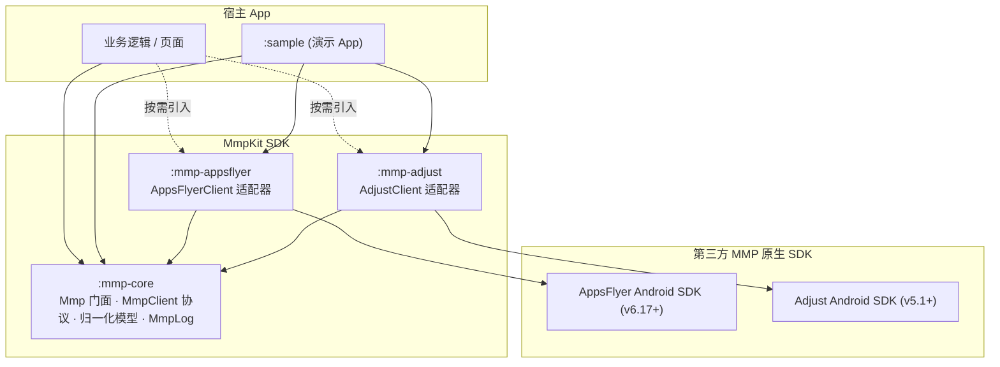
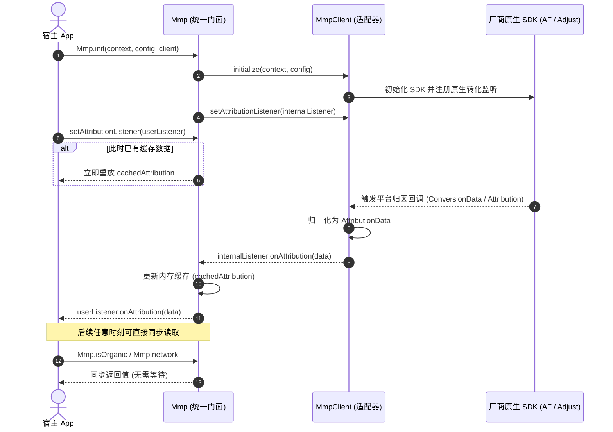

# MmpKit-Android

[-blue.svg)](#环境要求)
[](#1-添加依赖-jitpack)
[](#模块说明)
[](LICENSE)

Android 移动归因（Mobile Measurement Partner, MMP）统一封装架构。业务层只依赖单一门面 `Mmp`，通过在初始化时替换底层适配器（`AppsFlyerClient` / `AdjustClient` 等），实现零业务侵入、零调用侧改动的 MMP 平台平滑切换。

---

## 核心特性

- **统一门面 API**：业务层完全与具体 MMP SDK 解耦，通过 `Mmp.*` 完成事件上报、收入统计与归因读取。
- **归一化数据模型**：各厂商异构字段自动映射为标准化 `AttributionData`（`network`, `campaign`, `adGroup`, `creative`, `clickLabel`, `isOrganic`, `raw`）。
- **同步缓存直读（Hot Cache）**：归因结果自动内存缓存，支持通过 `Mmp.isOrganic`、`Mmp.network` 等同步属性即时读取，告别异步阻塞。
- **监听器重放机制**：随时调用 `setAttributionListener`，若此时已有缓存，框架会自动向新注册的监听器补发一次最新归因数据。
- **深度链接支持**：统一抽象标准 Deep Linking 与延迟深度链接（Deferred Deep Linking / UDL），无缝驱动路由跳转。
- **内置本地模拟测试（Mock Simulation）**：提供 Adapter 级别的归因与深链模拟方法，无需真机登记白名单或云端 OneLink 即可在本地闭环调试。
- **日志与安全脱敏**：统一受控的 `MmpLog` 日志器，敏感 Token 自动掩码脱敏，且与厂商 Debug 日志开关彻底解耦。

---

## 架构

### 模块依赖关系



### 归因时序与缓存流向



---

## 模块说明

| 模块 | 说明 | 外部依赖 |
| :--- | :--- | :--- |
| **`:mmp-core`** | **核心基础库（必选）**。定义 `Mmp` 门面、`MmpClient` 协议、归一化数据模型、`MmpLog` 等。 | **无**（纯 Kotlin，零第三方依赖） |
| **`:mmp-appsflyer`** | **AppsFlyer 适配器（可选）**。实现 `AppsFlyerClient`，负责转化数据映射与 UDL 深度链接解析。 | `com.appsflyer:af-android-sdk` |
| **`:mmp-adjust`** | **Adjust 适配器（可选）**。实现 `AdjustClient`，负责 `AdjustAttribution` 映射与延迟深链解析。 | `com.adjust.sdk:adjust-android` |
| **`:sample`** | **示例 App**。基于 Jetpack Compose 构建，包含完整的业务埋点、同步读、异步刷新与本地 Mock 测试能力。 | 依赖上述模块 |

---

## 快速接入

### 1. 添加依赖 (JitPack)

在项目根目录 `settings.gradle.kts` 中添加 JitPack 仓库源：

```kotlin
dependencyResolutionManagement {
    repositories {
        google()
        mavenCentral()
        maven(url = "https://jitpack.io")
    }
}
```

在业务模块的 `build.gradle.kts` 中按需添加依赖（替换 `1.0.0` 为实际版本号）：

```kotlin
dependencies {
    // 1. 核心库（必选）
    implementation("com.github.e-hai.MmpKit-Android:mmp-core:1.0.0")

    // 2. 厂商适配器（按业务选型二选一）
    implementation("com.github.e-hai.MmpKit-Android:mmp-appsflyer:1.0.0")
    // implementation("com.github.e-hai.MmpKit-Android:mmp-adjust:1.0.0")
}
```

> **提示**：`:mmp-appsflyer` 与 `:mmp-adjust` 已通过 `api` 传递依赖了 `:mmp-core`，直接引入适配器模块即可自动引入核心库。

---

## 使用指南

### 1. 初始化

在自定义 `Application.onCreate` 中初始化统一门面：

```kotlin
class MyApplication : Application() {
    override fun onCreate() {
        super.onCreate()

        // 1. 装配配置
        val config = MmpConfig(
            appToken = "YOUR_DEV_KEY_OR_APP_TOKEN", // AppsFlyer devKey 或 Adjust appToken
            isDebug = BuildConfig.DEBUG,           // 开启厂商 SDK 调试模式 / Sandbox
            appId = null,                          // 可选应用标识
            enableLog = BuildConfig.DEBUG,         // 开启 MmpKit 内部日志
        )

        // 2. 选配厂商适配器并初始化 Mmp 门面
        Mmp.init(
            context = this,
            config = config,
            client = AppsFlyerClient(), // 切换厂商仅需更换此处为 AdjustClient()
        )

        // 3. （可选）注册归因数据监听（首次或更新时回调）
        Mmp.setAttributionListener { data ->
            Log.d("Mmp", "归因回调到达: network=${data.network}, isOrganic=${data.isOrganic}")
        }

        // 4. （可选）注册深度链接监听（处理冷启动或延迟深度链接唤起）
        Mmp.setDeepLinkListener { result ->
            Log.d("Mmp", "收到深度链接: value=${result.deepLinkValue}, deferred=${result.isDeferred}")
        }
    }
}
```

---

### 2. 事件与收入上报

业务埋点统一通过门面 `Mmp.*` 调用：

```kotlin
// 普通业务事件上报
Mmp.trackEvent(
    name = "level_complete",
    params = mapOf("level" to 3, "score" to 1200)
)

// 收入与购买事件上报
Mmp.trackRevenue(
    MmpRevenue(
        revenue = 9.99,
        currency = "USD",           // ISO 4217 三位货币代码
        eventName = "purchase",     // 注意：Adjust 下此处需传控制台配置的 event token
        params = mapOf("sku" to "coin_pack_s"),
    )
)
```

> **特别注意 (Adjust 规则)**：Adjust 系统不接收任意字符串事件名，其 `MmpEvent.name` 与 `MmpRevenue.eventName` 必须对应 Adjust 控制台预先生成的 **event token**（如 `abc123`）。

---

### 3. 读取归因数据（同步直读）

归因结果到达后会自动保存在门面缓存中。在绝大多数业务场景下，直接**同步读取属性**即可，无需嵌套任何异步回调：

```kotlin
// 区分自然量用户 vs 买量用户
if (Mmp.isOrganic == true) {
    // 自然量用户分支
} else if (Mmp.isOrganic == false) {
    // 买量付费用户分支
} else {
    // 归因尚未就绪 (null)
}

// 同步获取核心投放维度
val network: String? = Mmp.network     // 媒体渠道 / 广告网络 (如 googleadwords_int, Facebook Ads)
val campaign: String? = Mmp.campaign   // 广告活动名称
val adGroup: String? = Mmp.adGroup     // 广告组 / 广告集
val creative: String? = Mmp.creative   // 广告创意 / 素材
val clickLabel: String? = Mmp.clickLabel // 点击标识
val fullData: AttributionData? = Mmp.attribution // 完整归一化模型
```

#### 归一化字段对照表

| 归一化字段 | 类型 | AppsFlyer 映射字段 | Adjust 映射字段 | 业务含义 |
| :--- | :--- | :--- | :--- | :--- |
| `network` | `String?` | `media_source` | `network` | 广告渠道 / 媒体来源 |
| `campaign` | `String?` | `campaign` | `campaign` | 广告活动名称 |
| `adGroup` | `String?` | `adgroup` / `af_adset` | `adgroup` | 广告组名称 |
| `creative` | `String?` | `af_ad` / `adgroup` | `creative` | 素材创意标识 |
| `clickLabel` | `String?` | `af_c_id` | `clickLabel` | 点击标识 |
| `isOrganic` | `Boolean` | `af_status == "Organic"` | `network` 为空或等于 `"Organic"` | 是否自然量 |
| `raw` | `Map<String, Any?>` | 完整原始回调 Map | 完整原始回调 Map | 未归一化字段兜底 |

若需主动向厂商服务端刷新归因数据：

```kotlin
Mmp.getAttribution { data ->
    // 异步查询并同步刷新本地缓存
    Log.d("Mmp", "服务端归因拉取结果: $data")
}
```

---

### 4. 深度链接 (Deep Linking)

支持统一标准 Deep Link 与延迟深度链接（Deferred Deep Link）：

```kotlin
Mmp.setDeepLinkListener { result ->
    val url = result.deepLinkValue // 链接地址，如 myapp://promo/spring_sale
    val params = result.clickEvent  // 携带的点击参数 Map
    val isDeferred = result.isDeferred // 是否为安装后延迟启动唤起
    
    // 执行应用内路由跳转
}
```

---

### 5. 本地模拟测试 (Mock Simulation)

AppsFlyer 官方并未提供本地断网测试或 Mock API，传统测试必须依赖白名单真机和 OneLink 链接。为方便本地开发与 UI 走查，MmpKit 提供了**一键本地模拟入口**：

```kotlin
val client = AppsFlyerClient()
Mmp.init(context, config, client)

// 1. 模拟收到买量归因
client.simulateConversionData(
    mapOf(
        "af_status" to "Non-organic",
        "media_source" to "googleadwords_int",
        "campaign" to "summer_sale_2026",
        "af_adset" to "group_android",
        "af_ad" to "banner_300x250",
    )
)

// 2. 模拟收到深度链接
client.simulateDeepLink(
    deepLinkValue = "myapp://promo/spring_sale",
    clickEvent = mapOf("campaign" to "spring_sale", "discount" to "50%"),
    isDeferred = true,
)
```

> 在内置的 `:sample` Demo 界面中，已配备 **"Mock Non-Organic"**、**"Mock Organic"**、**"Mock DeepLink"** 快捷测试按钮，点击即可实时观察状态流转。

---

### 6. 日志与调试

```kotlin
// 运行时动态开启或关闭日志
Mmp.setLogEnabled(true)
val isLogging = Mmp.isLogEnabled()
```

- Tag：`MmpKit`、`MmpKit/AppsFlyer`、`MmpKit/Adjust`
- 敏感 Token 自动脱敏：日志中输出的 `appToken` 会自动掩码为 `abcd****wxyz`。

---

## 混淆与清单配置 (ProGuard & Manifest)

### ProGuard / R8
`:mmp-core`、`:mmp-appsflyer` 与 `:mmp-adjust` 内部均已封装 `consumer-rules.keep` 规则，宿主集成时**无需额外手动添加混淆规则**。

### AndroidManifest 合并冲突处理
若引入 AppsFlyer 时与宿主 `AndroidManifest.xml` 的备份策略规则发生合并冲突，可在宿主 `<application>` 标签中添加：

```xml
<application
    tools:replace="android:dataExtractionRules,android:fullBackupContent"
    android:dataExtractionRules="@xml/data_extraction_rules"
    android:fullBackupContent="@xml/backup_rules"
    ... >
</application>
```

---

## 环境要求

- **最低支持**：Android 7.0+ (API Level 24)
- **编译目标**：compileSdk 37 / targetSdk 37
- **Java 版本**：Java 11+
- **构建工具**：Gradle 9.0+ / Android Gradle Plugin 8.9+

---

## 示例工程运行

克隆本仓库并在 Android Studio 中打开即可直接运行 `:sample` 模块：

```bash
git clone https://github.com/e-hai/MmpKit-Android.git
cd MmpKit-Android
./gradlew :sample:installDebug
```

---

## 发布至 JitPack (维护者参考)

1. 确认 `gradle.properties` 中的 `GROUP` 与 `VERSION_NAME`：
   ```properties
   GROUP=com.github.e-hai.MmpKit-Android
   VERSION_NAME=1.0.0
   ```
2. 本地发布校验：
   ```bash
   ./gradlew :mmp-core:publishReleasePublicationToMavenLocal \
     :mmp-appsflyer:publishReleasePublicationToMavenLocal \
     :mmp-adjust:publishReleasePublicationToMavenLocal \
     --no-configuration-cache
   ```
3. Push 至 GitHub 并打 Release Tag（如 `1.0.0`）。
4. 在 [JitPack MmpKit-Android](https://jitpack.io/#e-hai/MmpKit-Android) 触发构建即可。

---

## License

本项目遵循 [MIT License](LICENSE) 开源协议。
