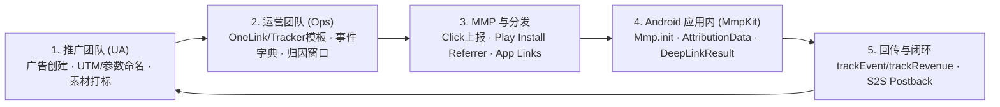

# MmpKit-Android 全链路归因与深度链接 SOP（推广 → 运营 → SDK 识别）

本文档定义业务在使用 **MmpKit-Android**（AppsFlyer / Adjust 统一门面）时，从**市场投放推广**、**运营与 MMP 后台配置**、**Google Play 分发**到**Android 应用内 SDK 识别与业务响应**的全链路标准作业程序（SOP）。

---

## 1. 全链路角色分工与流程总览



| 阶段 | 负责团队 | 核心交付物 / 动作 | 常见卡点 |
| :--- | :--- | :--- | :--- |
| **一、推广投放** | UA / 增长 / 市场 | 按标准规范生成投放链接参数、指定 `deep_link_value` | 渠道命名不规范、大小写混用导致客户端解析异常 |
| **二、运营配置** | 运营 / 产品 | 配置 OneLink / Adjust Link 模板、维护《事件字典》 | 漏配 SHA-256 指纹、Adjust 忘记下发 6 位 Event Token |
| **三、技术前置** | Android / 服务端 | 部署 `assetlinks.json`、配置 Manifest IntentFilter、集成 MmpKit | `assetlinks.json` 证书指纹错误、混淆规则缺失 |
| **四、应用内识别** | Android 客户端 | 冷启动 `Mmp.init`、挂载监听、处理 `handleDeepLink` 与同步读取 | 监听注册时机过晚、同一深链重复弹窗 |
| **五、联调上线** | QA / 研发 / 运营 | 离线 Mock → 白名单沙盒实机测试 → 生产关闭 `isDebug` | 生产环境忘记关闭 `isDebug` 导致 Adjust 数据进沙盒 |

---

## 2. 阶段一：推广与投放命名规范（UA / 增长）

所有付费买量渠道（Google Ads、Meta、TikTok）及自有渠道（短信、KOL、官网二维码、Push）均须遵循以下参数约定，以便与客户端 `AttributionData` 字段精准对齐：

1. **投放维度命名约定（推荐全小写 + 下划线，禁止空格）**
   - **媒体渠道 (`network`)**：如 `googleadwords_int`、`Facebook Ads`、`tiktok_int`、`kol_youtube`、`sms_recall`
   - **广告活动 (`campaign`)**：格式 `<业务目标>_<地域>_<日期>`，如 `spring_sale_us_202604`
   - **广告组 (`adGroup`)**：格式 `<定向人群>_<版位>`，如 `lookalike_18_35_feed`
   - **创意素材 (`creative`)**：如 `video_01_hook_a`
   - **子渠道 / 点击标签 (`clickLabel`)**：如 `kol_alex`、`landing_btn_top`
2. **深度链接跳转参数约定**
   - `deep_link_value`：目标落地路由或页面标识（例如 `mmpkit://promo/spring_sale` 或 `vip_paywall`）
   - 透传业务参数（客户端会在 `DeepLinkResult.clickEvent` 中获取）：统一使用下划线命名，如 `invite_code`、`coupon_id`、`sku_id`

---

## 3. 阶段二：运营与 MMP 后台配置（Ops / 产品）

### 3.1 应用标识与 Android App Links 前置绑定（一次性配置）
1. **收集签名证书指纹**：在服务端与 MMP 后台填入 Google Play App Signing / Release Keystore 的 `SHA-256` 证书指纹与 `applicationId`。
2. **部署 `assetlinks.json`**：确保 `https://<你的推广域名>/.well-known/assetlinks.json` 可公网 HTTPS 200 访问（`Content-Type: application/json`），无跳转重定向。
3. **配置 MMP 控制台**：
   - **AppsFlyer**：创建 OneLink Template（绑定子域名、启用 Android App Links、配置未安装跳 Google Play / 已安装直拉 App）。
   - **Adjust**：创建 Campaign Link / Tracker Token，配置 Android App Scheme 与 Universal/App Link 跳转规则。
4. **启用 Google Play Install Referrer**：确认工程依赖 `com.android.installreferrer:installreferrer`（`mmp-appsflyer` / `mmp-adjust` 已内置引入），并在广告后台确认默认归因窗口（建议点击 7 天、展示 24 小时）。

### 3.2 维护《跨端标准化事件字典》
> [!IMPORTANT]
> **MmpKit 核心差异说明**：
> - **AppsFlyer**：`MmpEvent.name` / `MmpRevenue.eventName` 为**可读字符串**（如 `af_purchase`）。
> - **Adjust**：`MmpEvent.name` / `MmpRevenue.eventName` 必须为 Adjust 后台创建的 **6 位 Event Token**（如 `abc123`）。
> 建议业务层通过统一事件映射表或远程配置屏蔽该差异。

| 业务事件 | MmpKit 调用 API | AppsFlyer 事件名 | Adjust Event Token (示例) | 必填参数 (`params`) |
| :--- | :--- | :--- | :--- | :--- |
| 完成注册 | `Mmp.trackEvent` | `af_complete_registration` | `reg001` | `method` (`google`/`email`) |
| 完成购买 | `Mmp.trackRevenue` | `af_purchase` | `pur002` | `revenue` (`Double`), `currency` (`"USD"`), `order_id` |
| 新手引导完成 | `Mmp.trackEvent` | `af_tutorial_completion` | `tut003` | `success` (`true`) |

---

## 4. 阶段三：Android 应用内 SDK 识别链路（客户端）

### 4.1 冷启动初始化与监听挂载（`Application.onCreate`）
```kotlin
class App : Application() {
    override fun onCreate() {
        super.onCreate()

        val config = MmpConfig(
            appToken = BuildConfig.MMP_TOKEN,
            isDebug = BuildConfig.DEBUG, // ⚠️ 发版必须为 false
            appId = null,                // Android 可为 null
            enableLog = BuildConfig.DEBUG,
        )

        // 1. 初始化（切换厂商只需替换 AppsFlyerClient() <-> AdjustClient()）
        Mmp.init(this, config, AppsFlyerClient())

        // 2. 挂载归因监听（带自动重放：若缓存已就绪会立即回调）
        Mmp.setAttributionListener { data ->
            // data.isOrganic / data.network / data.campaign / data.adGroup / data.creative
        }

        // 3. 挂载深度链接监听（覆盖冷启动延迟深链 + 热启动直接深链）
        Mmp.setDeepLinkListener { result ->
            // result.deepLinkValue / result.clickEvent / result.isDeferred
            AppRouter.handleDeepLink(result)
        }
    }
}
```

### 4.2 接收 Direct Deep Link（`MainActivity` / 入口 `Activity`）
1. 在 `AndroidManifest.xml` 为入口 Activity 配置 `android:launchMode="singleTop"` 及 App Links / URI Scheme `<intent-filter>`：
   ```xml
   <intent-filter android:autoVerify="true">
       <action android:name="android.intent.action.VIEW" />
       <category android:name="android.intent.category.DEFAULT" />
       <category android:name="android.intent.category.BROWSABLE" />
       <data android:scheme="https" android:host="go.example.com" />
   </intent-filter>
   ```
2. 在 `onCreate` 与 `onNewIntent` 中统一通过 `Mmp.handleDeepLink(this, intent)` 透传给底层 MMP SDK：
   ```kotlin
   override fun onCreate(savedInstanceState: Bundle?) {
       super.onCreate(savedInstanceState)
       Mmp.handleDeepLink(this, intent)
   }

   override fun onNewIntent(intent: Intent) {
       super.onNewIntent(intent)
       setIntent(intent)
       Mmp.handleDeepLink(this, intent)
   }
   ```

### 4.3 归因识别与业务决策消费
- **异步首次识别**：通过 `Mmp.setAttributionListener` 第一时间接收首包归因结果（区分自然量与买量转化）。
- **同步热缓存直读**：在后续任意页面（如 Paywall 付费墙、邀请弹窗、A/B 实验分桶），直接同步读取：
  ```kotlin
  when (Mmp.isOrganic) {
      false -> showCampaignPaywall(network = Mmp.network, campaign = Mmp.campaign)
      true  -> showDefaultPaywall()
      null  -> showLoadingOrDefault() // 归因尚未返回
  }
  ```
- **归一化字段映射参考**：

| 归一化字段 | AppsFlyer 原始字段 | Adjust 原始字段 |
| :--- | :--- | :--- |
| `network` | `media_source` | `network` |
| `campaign` | `campaign` | `campaign` |
| `adGroup` | `adgroup` / `af_adset` | `adgroup` |
| `creative` | `af_ad` / `adgroup` | `creative` |
| `clickLabel` | `af_c_id` | `clickLabel` |
| `isOrganic` | `af_status == "Organic"` | `network` 为空或 `"Organic"` |

### 4.4 深度链接防重复消费规范
- 当 `DeepLinkResult.isDeferred == true`（首次安装后激活延迟唤起），建议等首页初始化/登录检查完成后消费，并在本地（如 `SharedPreferences` / DataStore）记录消费状态，避免后续页面重建时重复跳转或重复弹领券框。

---

## 5. 阶段四：三阶测试验收与上线检查（QA & 发布）

### Level 1：本地离线 Mock 自测（研发自测）
无需注册测试设备或配置 OneLink，直接利用 Adapter 内置仿真方法验证业务状态流转：
```kotlin
(client as? AppsFlyerClient)?.simulateConversionData(
    mapOf("af_status" to "Non-organic", "media_source" to "googleadwords_int", "campaign" to "spring_sale")
)
(client as? AppsFlyerClient)?.simulateDeepLink(
    deepLinkValue = "mmpkit://promo/spring_sale",
    clickEvent = mapOf("coupon" to "50"),
    isDeferred = true,
)
```
也可使用 `adb` 命令直接测试 Direct Deep Link Intent 转发链路：
```bash
adb shell am start -W -a android.intent.action.VIEW -d "mmpkit://promo/spring_sale?coupon=50" com.kit.mmp.sample
```

### Level 2：MMP 沙盒白名单真机联调（提测验收）
- [ ] 测试机 GAID 已添加至 AppsFlyer **Test Devices** 或 Adjust **Testing Console** 白名单。
- [ ] `MmpConfig.isDebug = true`、`enableLog = true`，在 Logcat 过滤 `MmpKit` 观察脱敏初始化与回调日志。
- [ ] **卸载重装验证 Deferred Deep Link**：清除应用数据或卸载 → 手机浏览器点击测试短链 → 跳至商店页后本地安装或 Play 内测包启动 → 确认收到 `isOrganic == false` 且 `isDeferred == true`。
- [ ] **已安装验证 Direct Deep Link**：点击 App Link / URI Scheme → 确认拉起 App 并触发 `DeepLinkListener`（`isDeferred == false`）。
- [ ] **事件与收入验收**：触发注册与购买埋点 → 在 MMP 控制台 Live Stream / Testing Console 核对事件名称、金额与 `currency`。

### Level 3：生产发布上线 Checklist
- [ ] 发版构建已关闭调试开关：`MmpConfig.isDebug = false`、`enableLog = false`。
- [ ] Google Play 上线前使用 `adb shell pm get-app-links <your.package.name>` 验证 App Links 域名校验状态为 `verified`。
- [ ] 上线后 48 小时盯盘核查：自然量 (`isOrganic == true`) 占比是否突发异常、Postback S2S 回传广告平台是否正常。
